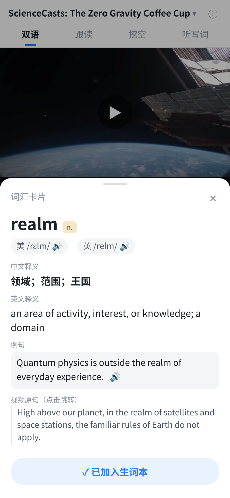
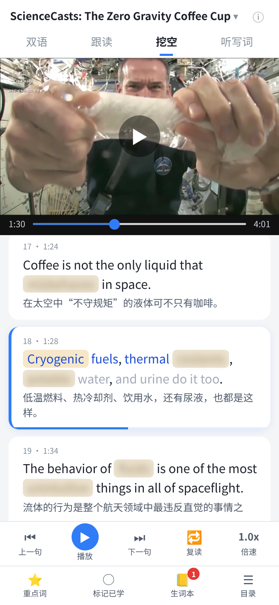
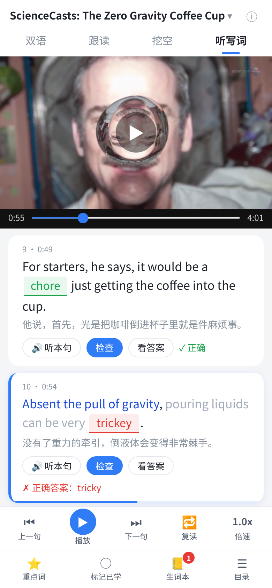
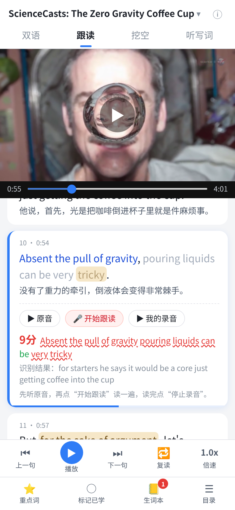
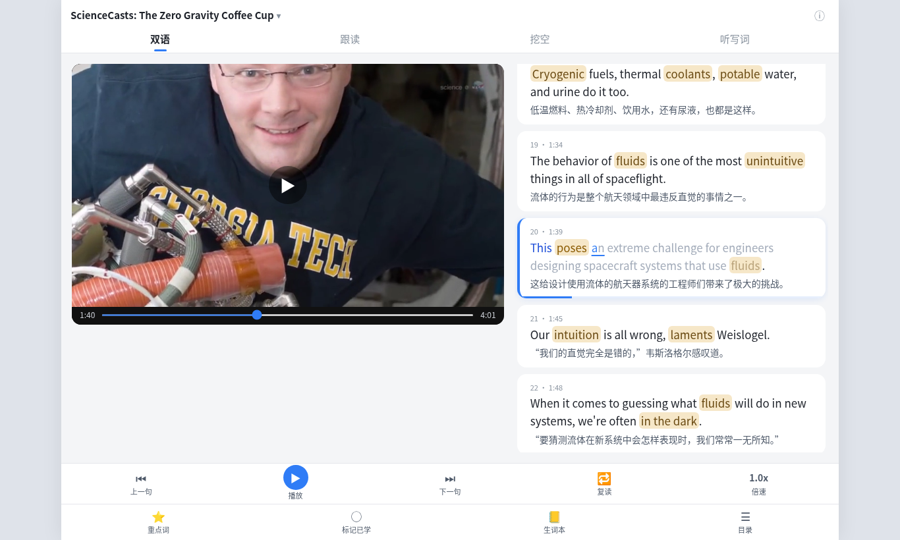
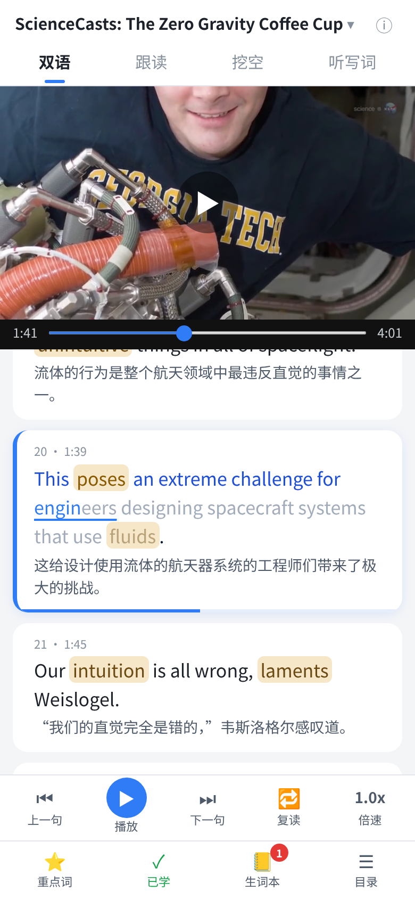

# 看视频学英语

看视频学英语（english-proto）是一个用短视频学英语的网页原型：一句一句看双语字幕，当前词跟着声音高亮，点词查释义，也可以跟读、挖空和听写。前端是静态 HTML / CSS / JS，没有构建步骤。`pipeline/build_lesson.py` 可以把一段你有权使用的英文视频做成带逐词时间轴、中文翻译和词汇卡片的课程。

仓库里只附带一节课：**ScienceCasts: The Zero Gravity Coffee Cup**（NASA，4 分 01 秒，44 句，30 个重点词）。来源是 [Wikimedia Commons 上的该文件](https://commons.wikimedia.org/wiki/File:ScienceCasts-_The_Zero_Gravity_Coffee_Cup.webm)，美国政府作品，公有领域。打开页面就会加载它（`lessons/index.json` 的第一项）。

## 功能

这些都在 `assets/app.js` 里，对应页面上的控件：

- **双语字幕，逐词高亮（卡拉 OK）**。每句一个气泡，当前句左侧有蓝条，并滚到中间。当前句按逐词时间从左到右填色：已读的词变蓝，正在读的词有颜色扫过和下划线，没读到的词变浅。气泡底部有一条细进度条，表示这一句播了多少。用 `requestAnimationFrame` 每帧更新，拖动、倍速、复读都跟着走。没有时间戳的词按长度在相邻词之间插值。手动滚动后 4 秒内不会被自动滚动抢走。点句子跳到那一句。
- **词汇卡片和生词本**。重点词是米色标签。点开卡片可以看到单词、词性、美式 / 英式音标（浏览器 `speechSynthesis` 朗读）、中英文释义、例句、视频原句（点击跳转），以及「加入生词本」。生词本存在 `localStorage`（`ep_wordbook`），角标显示数量，各课共用。
- **跟读：录音和打分**。`MediaRecorder` 录音，可回放自己的录音和原音。Chrome / Edge 里用 Web Speech API 识别，再按逐词匹配率打分（最长公共子序列对齐，标出对错的词）。这不是发音评分。不支持识别时仍可录音对比。
- **挖空**。重点词被遮住，点一下显示，再点打开词卡。被遮住的词仍在走进度，但不会把词露出来。
- **听写词**。听本句，填写这句抽到的重点词，可以检查或看答案，回车也会检查。答案空位不参与逐词高亮。
- **复读、上一句、下一句、倍速**。倍速是 0.75 / 1.0 / 1.25，记在 `localStorage`。进度条可以拖动，点画面播放或暂停。
- **重点词、已学、目录**。底部可以打开重点词列表、把本课标成已学（`ep_learned`）、生词本，以及全部句子的目录（点击跳转）。
- **课程切换**。`lessons/index.json` 里多于一节课时，点顶部标题（带 ▾），或在目录、来源弹层里切换。选择记在 `ep_lesson`，并写到地址栏 `?lesson=<id>`。只有一节课时不显示切换入口，直接加载列表第一项。没有 `lessons/index.json` 时，退回读取根目录的 `lesson.json`。

另外：右上角 ⓘ 显示该课的来源、片段和授权。桌面键盘：空格播放 / 暂停，← → 上一句 / 下一句，Esc 关闭弹层。屏幕宽度 ≥ 980px 时，左边是视频，右边是字幕。

## 截图

双语字幕，点开词汇卡片。



挖空：重点词被遮住，点一下显示。



听写词：听本句，填写缺失的词。



跟读：录音、回放，并按识别结果打分。



宽屏时视频在左、字幕在右。



当前句的逐词填色和句内进度条。



## 快速开始

需要 Python 3（只用标准库）：

```bash
python serve.py 8000
```

然后打开 <http://localhost:8000>。

请用 `serve.py`，不要用 `python -m http.server`。标准库的 `http.server` 不处理 HTTP Range 请求，Chrome / Edge 里视频无法跳到某一句，点句子、上一句 / 下一句、复读都会失效。`serve.py` 在标准库服务器上加了 Range。`npx serve` 这类支持 Range 的服务器也可以。

不要直接双击 `index.html`。`file://` 下读不到 `lesson.json`。

跟读的语音识别在 **Chrome 或 Edge** 里可用，并且需要联网（Chrome 走的是在线识别）。Firefox 没有这套识别，Safari 支持有限；不支持时仍可录音回放。录音还要求安全环境：`http://localhost` 可以。手机用局域网 IP（例如 `http://192.168.x.x:8000`）打开时，浏览器会禁用麦克风，需要 HTTPS。

## 项目结构

```
index.html                 页面
assets/style.css           样式
assets/app.js              全部前端逻辑
lessons/index.json         课程列表（第一项是默认课程）
lessons/<id>/lesson.json   课程数据
lessons/<id>/video.mp4     视频（H.264 + AAC，faststart）
serve.py                   带 Range 的静态服务器（仅标准库）
pipeline/build_lesson.py   从视频生成课程
pipeline/verify_ui.py      无头浏览器检查，并截图
pipeline/requirements.txt
pipeline/work/<id>/transcript.json   识别结果（逐词时间）
pipeline/work/<id>/enrich.json       断句合并、纠错、中文、重点词
screenshots/               界面截图
```

随仓库提交的样例是 `lessons/nasa-coffee/`，以及已经填好的 `pipeline/work/nasa-coffee/transcript.json` 和 `enrich.json`。`.gitignore` 会忽略 `.venv/`、`__pycache__/`、`lessons_work/`、`pipeline/work/<id>/` 里下载的原始媒体，以及除 `lessons/nasa-coffee/video.mp4` 以外的 `*.mp4`。

## 课程 JSON

`lesson.json` 大致如下（样例节选）：

```json
{
  "id": "nasa-coffee",
  "title": "ScienceCasts: The Zero Gravity Coffee Cup",
  "source_url": "https://commons.wikimedia.org/wiki/File:ScienceCasts-_The_Zero_Gravity_Coffee_Cup.webm",
  "section": "",
  "license": "Public domain (NASA / ScienceAtNASA)",
  "video": "lessons/nasa-coffee/video.mp4",
  "duration": 241.4,
  "sentences": [
    {
      "id": 1,
      "start": 3.58,
      "end": 8.11,
      "en": "The Zero-Gravity Coffee Cup, presented by Science@NASA",
      "zh": "《零重力咖啡杯》，由 Science@NASA 出品",
      "words": [{ "w": "The", "s": 3.73, "e": 4.33 }]
    }
  ],
  "vocab": [
    {
      "word": "realm",
      "match": ["realm"],
      "pos": "n.",
      "ipa_us": "/rɛlm/",
      "ipa_uk": "/relm/",
      "def_en": "an area of activity, interest, or knowledge; a domain",
      "def_zh": "领域；范围；王国",
      "example": "Quantum physics is outside the realm of everyday experience.",
      "sentence_ids": [2]
    }
  ]
}
```

`words` 是这一句的逐词时间，供卡拉 OK 对齐。`vocab.match` 是字幕里实际出现的写法；`sentence_ids` 由管线按词形自动填上。

`lessons/index.json`：

```json
{
  "lessons": [
    {
      "id": "nasa-coffee",
      "title": "ScienceCasts: The Zero Gravity Coffee Cup",
      "path": "lessons/nasa-coffee/lesson.json"
    }
  ]
}
```

## 生成自己的课程

只用你有权使用的视频。下面的地址是占位符，换成你自己的文件或链接。

### 安装

需要 Python 3.9+ 和 ffmpeg（`apt install ffmpeg`、`brew install ffmpeg`，或在 Windows 上安装 ffmpeg 并加入 PATH）。

```bash
python3 -m venv .venv && source .venv/bin/activate
pip install -r pipeline/requirements.txt
```

### 第 1 遍：下载、转码、识别、断句

在项目根目录运行。`--lesson-id` 会把课写到 `lessons/<id>/`，并登记进 `lessons/index.json`：

```bash
python pipeline/build_lesson.py \
  --input "https://example.com/a-video-you-have-rights-to.mp4" \
  --lesson-id my-lesson \
  --default \
  --section "1:20-5:10" \
  --model small.en \
  --out . \
  --title "课程标题" \
  --source-url "https://example.com/original-page" \
  --license "CC BY 4.0 / Public domain / ..."
```

常用参数：

| 参数 | 作用 |
|---|---|
| `--input` | 直链、本地路径，或任何 yt-dlp 能下的页面 |
| `--lesson-id` | 写入 `lessons/<id>/` 并登记。不加则走旧的单课模式：`./lesson.json` 和 `media/video.mp4` |
| `--default` | 放到课程列表第一项（默认课） |
| `--section START-END` | 只要这一段，例如 `1:20-5:10`。网页用 yt-dlp `--download-sections`，本地文件用 ffmpeg 裁剪 |
| `--yt-args` | 额外的 yt-dlp 参数。YouTube 若提示要登录验证，可以试 `--yt-args "--extractor-args youtube:player_client=android"`（有时只能下到较低清晰度） |
| `--model` | faster-whisper 模型。默认 `base.en`；`tiny.en` 更快，`small.en` 更准 |
| `--max-mb` | 成片大小上限，默认 30。超过就降分辨率、提高压缩 |
| `--skip-asr` | 复用已有的 `transcript.json`，不再识别 |

这一遍会：

1. 下载。直链用 urllib，其他网址交给 yt-dlp；本地路径直接使用。
2. ffmpeg 转成 H.264 / AAC mp4（yuv420p、faststart）。从 480p 开始，超过 `--max-mb` 就降到 360p / 240p。文件在 `lessons/<id>/video.mp4`。
3. faster-whisper（CPU、int8）识别，带逐词时间戳，写到 `pipeline/work/<id>/transcript.json`。音频由 ffmpeg 解码成 16 kHz PCM，不依赖 faster-whisper 自带的 PyAV。
4. 按句末标点断句。停顿超过 1.2 秒（且当前句至少 4 个词）或一句超过 28 个词也会断开。
5. 若 `pipeline/work/<id>/enrich.json` 还不存在，会写一个模板，并先生成只有英文的 `lesson.json`（已经能播放）。

在 8 核 CPU 上，4–6 分钟的视频用 `small.en` 识别大约 30 秒。

自己生成的 `video.mp4` 默认被 `.gitignore` 忽略。确认有权再分发时，用 `git add -f lessons/<id>/video.mp4`。

### 第 2 步：填写 enrich.json

已填好的例子见 `pipeline/work/nasa-coffee/enrich.json`。格式：

```json
{
  "merge": [[15, 16], [27, 28]],
  "fixes": [
    {"from": "Weisslogel", "to": "Weislogel"},
    {"from": "who perform the", "to": "who performed the", "ids": [35]}
  ],
  "translations": { "1": "第一句的中文", "2": "..." },
  "vocab": [
    {
      "word": "break loose",
      "match": ["breaks loose"],
      "pos": "phr. v.",
      "ipa_us": "/ˌbreɪk ˈlus/",
      "ipa_uk": "/ˌbreɪk ˈluːs/",
      "def_en": "...",
      "def_zh": "...",
      "example": "..."
    }
  ]
}
```

- `merge`：把被停顿拆开的句子合回去，编号用 `transcript.json` 里的 id。合并后句子会重新编号。`fixes` 和 `translations` 用的是新编号：可以先放一个空的 `translations`，用 `--skip-asr` 跑一遍，到 `lesson.json` 里看新编号。
- `fixes`：改识别错误（人名、专有名词、错词）。`ids` 可以限定句子。
- `translations`：键是句子 id。可以手写，也可以把 `transcript.json` 交给模型翻译后再校对。
- `vocab`：大约 15–30 个。不用填 `sentence_ids`，脚本会按原文匹配（含常见的 -s / -ed / -ing 等变化，以及词组）。词形不规则时，用 `match` 写出字幕里的样子。找不到的词会打印警告。

### 第 3 遍：合并成最终 lesson.json（不再识别）

```bash
python pipeline/build_lesson.py --input x --out . --lesson-id my-lesson --skip-asr \
  --title "课程标题" --source-url "https://example.com/original-page" --license "..."
```

### 界面检查（可选）

```bash
playwright install chromium
python serve.py 8765 &
python pipeline/verify_ui.py http://127.0.0.1:8765/ screenshots/
```

脚本会按 NASA 这节课做播放、卡拉 OK、挖空、听写、跟读和截图检查。课程目录里只有一节课时，不会要求出现「切换课程」入口。

## 技术概览

- **前端**：单个 `index.html` 加 `assets/app.js`、`assets/style.css`，无打包。字幕、词卡、挖空、听写、跟读都在这一份脚本里。
- **卡拉 OK**：`requestAnimationFrame` 里读 `video.currentTime`，按句内词的起止时间改 class 和 `--p`，而不是靠 `timeupdate`（那个事件不够密）。
- **跟读**：`MediaRecorder` 存成本句录音；`SpeechRecognition` / `webkitSpeechRecognition`（`en-US`）出文字；再用 LCS 和原句逐词对齐打分。
- **朗读**：词卡音标和例句用 `speechSynthesis`。没有 en-GB 语音时，会改用默认英语并提示。
- **管线**：yt-dlp 下载非直链页面，ffmpeg 转码，faster-whisper 做带逐词时间的识别，再合并 `enrich.json` 里的翻译和词汇。
- **本地服务器**：`serve.py` 用 `ThreadingHTTPServer`，对文件请求返回 206 和 `Content-Range`，否则浏览器不能在 mp4 里随意 seek。

## 版权

只用你有权使用的视频：美国政府作品（NASA、NOAA、NIH 等）、Wikimedia Commons / Internet Archive 上标明公有领域或 CC 的视频、CC BY 的演讲，等等。不要把电视剧、电影或其他受版权保护的片段放进仓库或公开传播。用 `--source-url` 和 `--license` 写上来源和授权，页面右上角 ⓘ 会显示。

本仓库附带的样例是 NASA ScienceCasts《The Zero Gravity Coffee Cup》，公有领域。这是一个原型：翻译和词卡是为这一节课编写的，新视频需要自己填 `enrich.json`。

## 已知限制

- 中文翻译和词卡不会自动生成。新视频要自己（或借助模型）填写 `enrich.json`，再校对。
- 英式朗读取决于系统里有没有 en-GB 语音。
- 跟读分数是逐词匹配率，不是发音好坏。
- 生词本跨课程共用。切换课程会整页重新加载。
- 没有 `lessons/index.json` 时，页面读取根目录的 `lesson.json`（旧的单课模式）。
